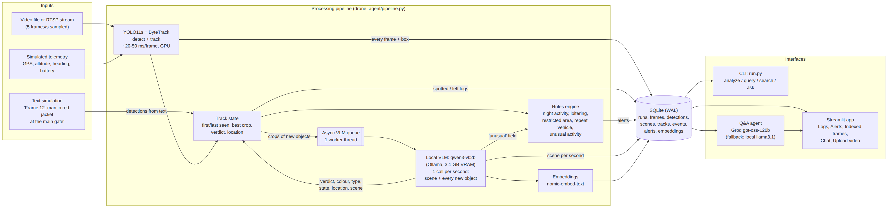

# Drone Security Analyst Agent

A prototype for a **docked security drone** that patrols a property. It processes video frames and drone
telemetry, identifies objects and events, logs them with context, raises security alerts from predefined
rules, indexes every frame in a database, and answers questions about the footage in a chat.

Everything that sees the video runs **locally and free**: YOLO11 on the GPU and a 2B vision-language model
through Ollama. Only the Q&A chat uses a free cloud LLM API (Groq), and it falls back to a local model.

| Output | Example from this repo's database |
|---|---|
| **Log** | `A person wearing a face mask and carrying a backpack spotted on the west sidewalk, 23:59:00` |
| **Alert** | `A person wearing a face mask … loitering on the west sidewalk for over 10s, 23:59:10` |
| **Alert** | `Unusual activity: car drifting through the area, 23:58:27; then car crashing through a fence, 23:58:28` |
| **Indexed frames** | every analysed frame queryable by time or object: `python run.py query --label truck` |
| **Chat** | "show me the red car" → answer + matching logs + the frames with the car boxed |

---

## Contents
1. [How it works](#how-it-works)
2. [Setup](#setup)
3. [Running it](#running-it)
4. [The Streamlit app](#the-streamlit-app)
5. [Alert rules](#alert-rules)
6. [Configuration](#configuration)
7. [Testing](#testing)
8. [Results on the test videos](#results-on-the-test-videos)
9. [Project structure](#project-structure)
10. [Design decisions](#design-decisions)
11. [Limitations and next steps](#limitations-and-next-steps)
12. [AI tools used](#ai-tools-used)

Detailed architecture with diagrams: **[docs/ARCHITECTURE.md](docs/ARCHITECTURE.md)**

---

## How it works



1. **Input.** A video file (or RTSP stream) sampled at 5 frames/s, or a **text simulation** where frames are
   descriptions (`Frame 12: man in red jacket at the main gate | Time 23:59:42, Alt 40 m …`).
   **Telemetry** (GPS, altitude, heading, battery, clock time) is simulated for a drone patrolling a property.
2. **Detection + tracking.** YOLO11s with ByteTrack finds objects (all 80 COCO classes) and gives each one a
   stable track id, so an object is logged once, not once per frame.
3. **VLM verification.** Once per second of video, one call to a local VLM (`qwen3-vl:2b`) gets the full
   frame plus a numbered sheet of crops of new objects. It returns a **scene description** and, per object:
   is it really what YOLO said, colour, type, state, **location** (by visible landmarks: "at the gate",
   "on the main road near the traffic lights") and a short description. False YOLO detections are
   rejected; wrong YOLO classes are corrected. This runs on a background thread, so it never stalls the video.
4. **Rules.** Verified objects and the VLM's per-second scene feed the rules engine, which raises alerts
   timestamped at the moment the condition happened.
5. **Storage.** Everything goes into SQLite: every frame (time + telemetry), every raw detection, the
   per-second scene descriptions, objects with their VLM attributes, logs, alerts and text embeddings.
6. **Interfaces.** A Streamlit app (logs, alerts, indexed frames, chat, video upload) and a command line.

---

## Setup

Tested on Ubuntu with Python 3.12 and an NVIDIA RTX 3080 (10 GB). The VLM needs about 3 GB of GPU memory,
YOLO about 1 GB.

### 1. Python environment
```bash
git clone https://github.com/ankush-365/assignment-flytbase.git
cd assignment-flytbase
python -m venv .venv
source .venv/bin/activate

# PyTorch matching your CUDA version first (https://pytorch.org/get-started/locally/), e.g. CUDA 12.4:
pip install torch==2.5.1 torchvision==0.20.1 --index-url https://download.pytorch.org/whl/cu124

pip install -r requirements.txt
```

### 2. YOLO weights
```bash
mkdir -p models
wget -P models https://github.com/ultralytics/assets/releases/download/v8.3.0/yolo11s.pt
```

### 3. Ollama (local VLM + embeddings)
Install Ollama from https://ollama.com, then:
```bash
ollama pull qwen3-vl:2b-instruct     # VLM, ~1.9 GB download, ~3 GB VRAM
ollama pull nomic-embed-text:v1.5    # text embeddings for semantic search
ollama pull llama3.1                 # optional: local fallback for the chat
```

### 4. Groq API key (free tier, for the chat)
Create a key at https://console.groq.com/keys and put it in a `.env` file in the project root:
```
GROQ_API_KEY=gsk_...
```
`.env` is git-ignored. Without a key the chat falls back to the local `llama3.1`.

### 5. Videos (not in the repo)
The database already contains three analysed videos. To see their frames in the app (or re-run them), put
the clips here:

| File | Content | Source |
|---|---|---|
| `data/videos/drone_street.mp4` | 4K drone view of a street, daytime, 23.6 s | stock drone footage (Pexels / your own clip) |
| `data/videos/night_loiter.mp4` | night street, masked person lingering, 23 s | [Getty Images 1339983520](https://www.gettyimages.in/detail/video/alone-traveler-with-surgical-mask-walking-on-the-lonely-stock-footage/1339983520) |
| `data/videos/gate_breach.mp4` | night, car crashes through a fence gate, 54 s | [Getty Images 1208736653](https://www.gettyimages.in/detail/video/silver-2004-dodge-stratus-4-door-sedan-crashes-stock-video-footage/1208736653) |

Without the videos, logs, alerts, chat and the frame tables still work from the database; only frame
images are missing.

---

## Running it

### Analyse a video (full pipeline)
```bash
python run.py analyze --video data/videos/night_loiter.mp4 --start 2026-11-24T23:59:00 \
    --set detector.imgsz=768
```
- `--start` sets the simulated clock time of the first frame (the night rule uses it).
- `--set key=value` overrides any `config.yaml` value for this run (repeatable), e.g.
  `--set "rules.loitering.categories=[person, vehicle]"`.
- `--no-video` skips writing the annotated video; `--summary` prints an LLM summary at the end.

Each run is stored as a new entry in `data/drone_security.db`; earlier runs are kept.

### Text simulation (no video or GPU needed)
```bash
python run.py analyze --sim demo --duration 100 --start 2026-11-24T23:59:30
```
A scripted scene: a blue Ford F150 parks at the garage twice, a man in a red jacket lingers at the main gate,
a person walks into the backyard, a white Corolla and a dog pass by. It triggers all object rules:
```
Blue Ford F150 pickup truck spotted in front of the garage, 23:59:35
ALERT night_activity   Man in red jacket detected at the main gate during night hours, 23:59:40
ALERT loitering        Man in red jacket loitering at the main gate for over 10s, 23:59:50
ALERT restricted_zone  Person in black hoodie carrying a backpack in restricted area (in the backyard), 00:00:32
ALERT repeat_vehicle   Blue Ford F150 pickup truck seen again in front of the garage (2nd sighting, first at 23:59:35), 00:00:45
```
`--sim random --duration 3600 --arrivals 3` generates random traffic instead.

### Query the index (no LLM)
```bash
python run.py query --run 4 --alerts                     # all alerts of a run
python run.py query --run 2 --label truck                # "show all truck events"
python run.py query --run 6 --from-s 25 --to-s 55        # logs in a video-time window
python run.py query --run 4 --start 2026-11-24T23:59:00 --end 2026-11-24T23:59:05   # by clock time
python run.py query --run 2 --tracks --label car         # objects with their VLM attributes
python run.py query --run 4 --scenes --from-s 0 --to-s 5 # per-second VLM scene descriptions
python run.py search --run 2 "person carrying a bag"     # semantic search
```

### Ask questions / summary
```bash
python run.py ask --run 6 "what happened at the gate?"
python run.py ask --run 2                                # interactive, keeps follow-up context
python run.py summary --run 6
```

### Review page
```bash
python scripts/review_events.py --run 6    # -> data/output/review_run_6/index.html
```
An HTML page with every log, the frame at that moment with the object boxed, and the crop the VLM judged,
used to check the VLM's verdicts by hand.

---

## The Streamlit app

```bash
python -m streamlit run app.py      # http://localhost:8501
```

Pick a video in the sidebar (Gate breach, Night loiter, Drone street), then a view:

| View | What it shows |
|---|---|
| 📋 **Logs** | every spotted / left / rejected log; filter by type, object, time; open any log to see the frame with the object boxed, the VLM crop and all attributes |
| 🚨 **Alerts** | alert cards coloured by severity, each with the frame at the alert time |
| 🎞️ **Indexed frames** | the frame-by-frame index: time, clock, GPS, altitude, battery, labels; filter by time or object; open a frame to see all detections and that second's VLM scene description |
| 💬 **Chat** | questions in plain English; answers with logs and image evidence; follow-ups ("which of those were parked?") search within the previous results |
| ⬆️ **Upload video** | upload a clip (up to 2 minutes), set the clock start time, and run the whole pipeline with live progress; the result opens in Logs |

The chat works in three steps:
1. **Retrieval in code:** colour and object must both match ("red car" never returns a red traffic light),
   place words filter by VLM location, time phrases ("between 10 and 15 seconds", "at 23:59:45") set a
   window, and open questions use embedding similarity.
2. **One LLM call** (Groq `openai/gpt-oss-120b`, JSON mode) with a compact context of at most 15 objects
   and 3 scene descriptions.
3. The LLM decides whether you want to **see** something; if so the frames are cut from the video at the
   stored timestamps with the object boxed.

---

## Alert rules

Rules run only on **VLM-verified** objects, fire **once** per object, and need the object to be seen for at
least **1 s** (so a 1-2 frame false detection can't raise an alert). Alert times are when the condition
happened, not when the VLM answered.

| Rule | Severity | Fires when | Example |
|---|---|---|---|
| `night_activity` | warning | a person (optionally vehicle) is first seen between 22:00 and 05:00 | `Man in red jacket detected at the main gate during night hours, 23:59:40` |
| `loitering` | warning | a person (optionally vehicle) stays in view longer than 10 s | `Man in red jacket loitering at the main gate for over 10s, 23:59:50` |
| `restricted_zone` | critical | the VLM's location text contains a restricted keyword (default `backyard`) | `Person … in restricted area (in the backyard), 00:00:32` |
| `repeat_vehicle` | info | a vehicle with the same colour and a similar description returns ≥ 30 s after it left | `Blue Ford F150 pickup truck seen again … (2nd sighting, first at 23:59:35)` |
| `unusual_activity` | critical | the VLM's per-second `unusual` field reports something (crash, forced entry, fire, climbing a fence …); details within 10 s extend the same alert | `Unusual activity: car drifting through the area, 23:58:27; then car crashing through a fence, 23:58:28` |

---

## Configuration

All settings live in [`config.yaml`](config.yaml) and can be overridden per run with `--set`.

| Section | Key settings |
|---|---|
| `source` | `sample_fps: 5`, default video, clock `start_time` |
| `telemetry` | home GPS, altitude, patrol radius/period, battery drain |
| `detector` | `yolo11s.pt`, `conf: 0.25` (permissive: the VLM filters), `imgsz: 1920` for 4K (use 768 for small clips) |
| `vlm` | `qwen3-vl:2b-instruct`, one call per second, up to 12 crops per call, token budget, 2 attempts per crop |
| `rules` | thresholds, night window, categories, restricted keywords, `min_track_s: 1.0` |
| `agent` | Groq model, local fallback model, max objects/scenes in the chat context, 20 s timeout |

---

## Testing

```bash
python -m pytest -v        # 66 tests, ~0.2 s, no GPU / Ollama / API key needed
```
The tests use the text simulation, a mock VLM and hash embeddings, and write to a temporary database.

| File | Tests | Covers |
|---|---|---|
| `tests/test_pipeline_sim.py` | 11 | end to end on the demo: "truck logged correctly" (exact log text and time), loitering at the main gate, night alerts across midnight, backyard intrusion, repeat F150, no alerts for the dog or the Corolla, no night alerts in daytime, every frame indexed with text + telemetry, queries by object / video time / clock time |
| `tests/test_rules.py` | 38 | night window edges (23:30 ✓, 05:00 ✗, 14:30 ✗), loitering at 10 s not 9 s and only once in 2 minutes, unverified objects and 0.2 s blips never alert, restricted keywords, repeat vehicle (2nd visit ✓, same visit ✗, different colour ✗), unusual activity (all forms of "none", cooldown, incident extension), message wording |
| `tests/test_search.py` | 11 | time parsing, "blue truck" vs "red truck", place filter, time windows, compact context, follow-ups stay within previous results |
| `tests/test_vlm_handling.py` | 6 | truncated-JSON salvage, missing objects, give-up after 2 attempts, YOLO class correction, VLM rejection |

The suite was mutation-checked: breaking the midnight window or the loitering threshold fails 6 tests;
disabling follow-ups fails 1.

The real-video pipeline was validated on the three clips below by checking every log against the frame
(review page) and fixing what was wrong (see `docs/ARCHITECTURE.md`).

---

## Results on the test videos

The database in this repo holds these three analyses.

| Video | Objects | Alerts | Timing (RTX 3080) |
|---|---|---|---|
| **Drone street** (4K, 23.6 s, daytime) | 80 verified: 44 cars, 12 people, 10 traffic lights, 9 trucks, 3 buses, 1 bicycle, 1 train | none (normal traffic) | YOLO 52.8 ms/frame · 24 VLM calls, avg 4.6 s · 137 s total |
| **Night loiter** (768×432, 23 s, clock 23:59) | masked person with backpack; a parking barrier (as "bench") | `night_activity` 23:59:00 · `loitering` 23:59:10 | YOLO 33.5 ms/frame · 23 VLM calls, avg 3.1 s · 96 s total |
| **Gate breach** (768×432, 54 s, clock 23:58) | white sedan; film-crew member at the end | `night_activity` (vehicle) 23:58:00 · `loitering` (vehicle) 23:58:10 · **`unusual_activity` "car drifting … then car crashing through a fence" 23:58:27** · `night_activity` (person) 23:58:51 | YOLO 19.9 ms/frame · 31 VLM calls, avg 3.0 s · 125 s total |

Example VLM scene description (night clip, t=1 s):
> A lone person wearing a face mask and carrying a backpack walks along a quiet, dimly lit urban street at
> night. The scene is isolated, with no other people or vehicles visible, and the street is illuminated by
> streetlights and a building's facade.

---

## Project structure

```
app.py                  Streamlit app: logs, alerts, indexed frames, chat, upload
run.py                  command line: analyze / query / search / ask / summary
config.yaml             all settings
drone_agent/
  sources.py            video reader + text simulator
  telemetry.py          simulated drone telemetry
  detector.py           YOLO11 + ByteTrack
  vlm.py                VLM prompt + JSON schema, crop sheet, salvage, embeddings, mock VLM
  pipeline.py           track state, VLM scheduling, verdicts, logs, rules, timing
  rules.py              alert rules (pure functions)
  db.py                 SQLite schema, writers and queries
  search.py             embedding search
  search_agent.py       Q&A: retrieval, LLM call, follow-ups, image evidence, summary
  config.py, types.py   config loader, dataclasses
scripts/review_events.py  HTML page to verify logs against the video
tests/                  pytest suite
docs/ARCHITECTURE.md    architecture, diagrams, design decisions, performance
docs/img/               diagram PNGs
data/drone_security.db  analysed runs (videos not included)
```

---

## Design decisions

Short version (full table in [docs/ARCHITECTURE.md](docs/ARCHITECTURE.md#7-design-decisions)):

- **YOLO + VLM instead of either alone.** YOLO is fast but trained on ground-level photos, so on drone
  footage it makes false detections (rooftops as "train", signs as "cell phone"). A VLM is accurate and
  descriptive but too slow for every frame. YOLO finds and tracks; the VLM verifies and describes.
- **qwen3-vl:2b locally.** Free, fits fully on a 10 GB GPU (3 GB), 3-5 s per call. Larger models
  (qwen2.5vl:3b / 7b) spilled to the CPU at 23-47 s per call.
- **One VLM call per second, not per object.** Cost is bounded by video length, and the same call gives the
  scene description used for unusual-activity alerts and for answering questions later.
- **Locations from the VLM, not drawn zones.** The drone moves, so a fixed region of the image covers
  different ground every second. The VLM names the place from visible landmarks instead.
- **SQLite.** One file, no server, enough for a property's daily footage; timestamps on every row make it
  queryable by time or object.
- **Retrieval in code + one LLM call for Q&A** (instead of a multi-step LangChain agent). The filters pick
  a small, relevant context; one call per question keeps answers fast and inside the free tier.

---

## Limitations and next steps

- **The VLM is the bottleneck** (~95% of processing time; videos run 2-6x slower than real time). Next:
  several VLM workers in parallel, or skipping seconds on live streams (`vlm.max_in_flight`).
- **A 2B VLM makes mistakes**: e.g. it accepted a parking barrier as a "bench" and a 21-pixel blur as a
  person. A larger VLM, or a detector trained on aerial imagery (VisDrone), would help.
- **The VLM only looks at seconds where YOLO found something**, so an event in an otherwise empty frame
  (smoke after the crash) gets no scene description.
- **Telemetry is simulated**, so locations are text. With real GPS + camera angles, objects could be placed
  on a map and checked against GPS geofences.
- **No recommended actions yet**: alerts say what happened, not what to do.
- **Brute-force vector search** is fine for one property; days of footage would use FAISS or pgvector.

---

## AI tools used

<!-- Describe how AI tools helped (the assignment asks for this). Draft below - edit to match your experience. -->

- **Claude Code** (Anthropic) was used throughout development as a pair programmer: proposing the
  architecture, writing the pipeline, VLM prompt and JSON schema, rules engine, database layer, Q&A
  retrieval, Streamlit app, test suite and these docs, and debugging with me on real runs (e.g. the VLM
  truncating its JSON, false "rejected" logs, a 0.2 s blip raising a night alert, the crash detail being
  dropped by the alert cooldown).
- Every change was reviewed and tested on the real clips; the plan and the decisions (scope, VLM choice,
  rules, what to drop) were mine.
- **Models used by the system:** YOLO11s (Ultralytics), qwen3-vl:2b-instruct and nomic-embed-text via
  Ollama, `openai/gpt-oss-120b` via Groq, llama3.1 as local fallback.
