# Architecture: Drone Security Analyst Agent

A prototype for a docked drone that patrols a property. It processes video frames and drone telemetry,
identifies and logs objects and events with context, raises security alerts from predefined rules,
indexes every frame in a database, and answers questions about the footage.

All diagrams below are Mermaid (rendered by GitHub). PNG versions are in [`docs/img/`](img/).

---

## 1. System overview

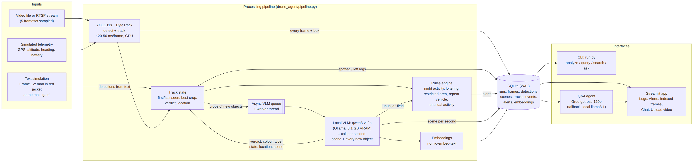

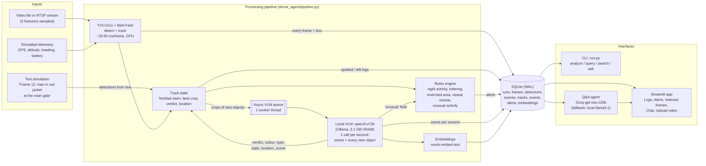

| Component | File | Role |
|---|---|---|
| Sources | `sources.py` | Video reader (file or RTSP, resampled to 5 fps) and the text simulator (scripted demo or random arrivals) |
| Telemetry | `telemetry.py` | Simulated docked-drone patrol: circular route, altitude jitter, battery drain, clock time per frame |
| Detector | `detector.py` | YOLO11s with ByteTrack (`model.track(persist=True)`); maps COCO labels to person / vehicle / object |
| VLM stage | `vlm.py` | One structured-JSON call per second: full frame + numbered crop sheet; salvage of cut-off JSON |
| Pipeline | `pipeline.py` | Track state, VLM scheduling, retries, verdicts, logs, rule evaluation, timing report |
| Rules | `rules.py` | Pure functions: (track state, time, config) → alerts |
| Storage | `db.py` | SQLite schema, writers, time / object / text queries |
| Q&A | `search_agent.py`, `search.py` | Retrieval from the DB + LLM answer + image evidence, follow-up context |
| UI | `app.py`, `run.py` | Streamlit dashboard and command line |

---

## 2. Per-frame flow (YOLO and VLM in parallel)

YOLO takes about 20-50 ms per frame; one VLM call takes 3-5 s. The VLM therefore runs on a background
thread and never blocks the frame loop. Every log and alert is stamped with the time the thing
**happened** in the video, not the time the VLM answered.

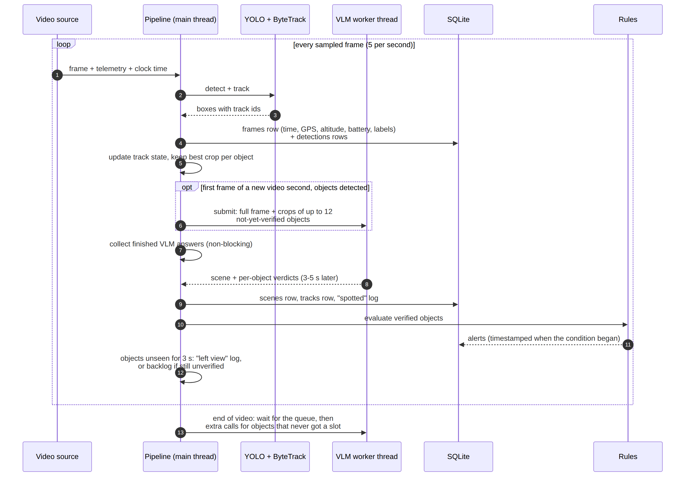

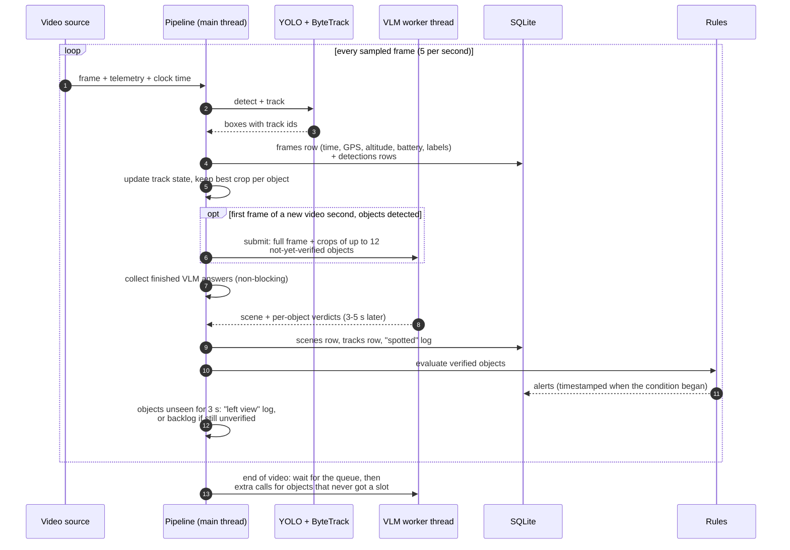

---

## 3. VLM verification

YOLO is trained on ground-level photos (COCO). On drone footage it produces false positives (rooftops as
"train", signs as "cell phone"). Every object is therefore checked by a small local VLM before it becomes a
log entry or can raise an alert. The VLM also adds what YOLO cannot see: colour, finer type, state, location
and a description.

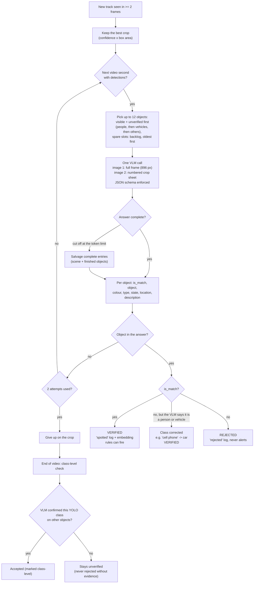

Token budget per call = 200 + 85 per crop, capped at 1600, so a runaway generation stops within seconds.
The first call of a video has no crops: it records the scene as context for later questions.

---

## 4. Alert rules

Rules only run on **VLM-verified** objects, fire **once** per object, and require the object to have been
seen for at least 1 s (a 1-2 frame blip never alerts). Every threshold is in `config.yaml` and can be
overridden per run (`run.py --set rules.loitering.seconds=30`).

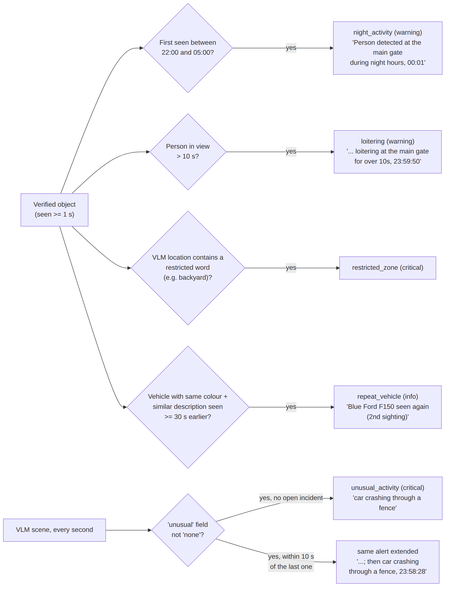

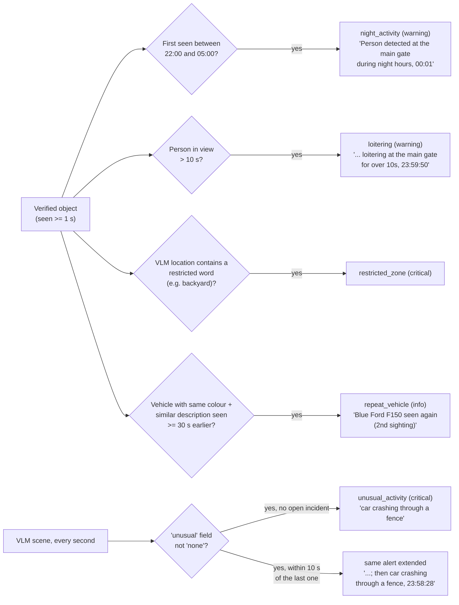

| Rule | Applies to | Condition | Timestamp |
|---|---|---|---|
| `night_activity` | people (vehicles optional) | first seen inside the night window | first seen |
| `loitering` | people (vehicles optional) | in view longer than 10 s | first seen + 10 s |
| `restricted_zone` | people, vehicles | VLM location text contains a configured keyword | entered that location |
| `repeat_vehicle` | vehicles | colour matches + description embedding similarity >= 0.90, previous sighting ended >= 30 s earlier | first seen this time |
| `unusual_activity` | whole scene | the VLM's per-second `unusual` field is not "none" | that second |

Locations are text from the VLM ("on the main road near the traffic lights", "at the gate"), not pixel
polygons: a moving drone's view changes every second, so fixed image regions would point at different ground.

---

## 5. Q&A agent

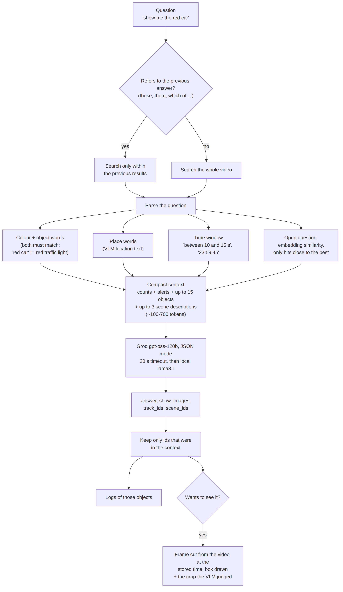

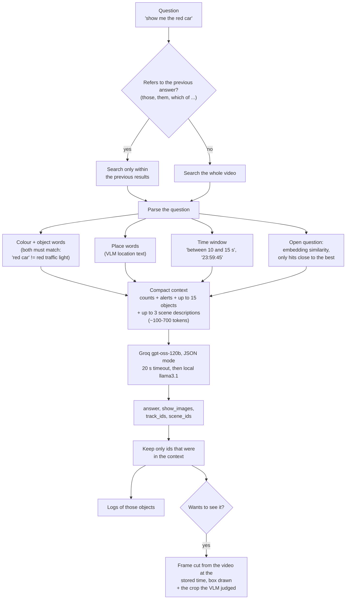

The prompt size does not grow with the length of the footage: at most 15 objects and 3 scenes are sent per
question, chosen by the filters above.

---

## 6. Database schema (frame-by-frame index)

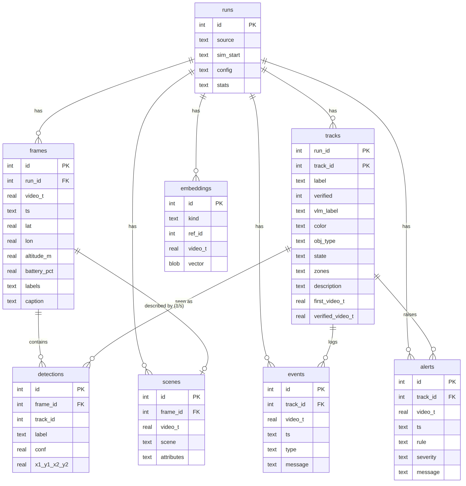

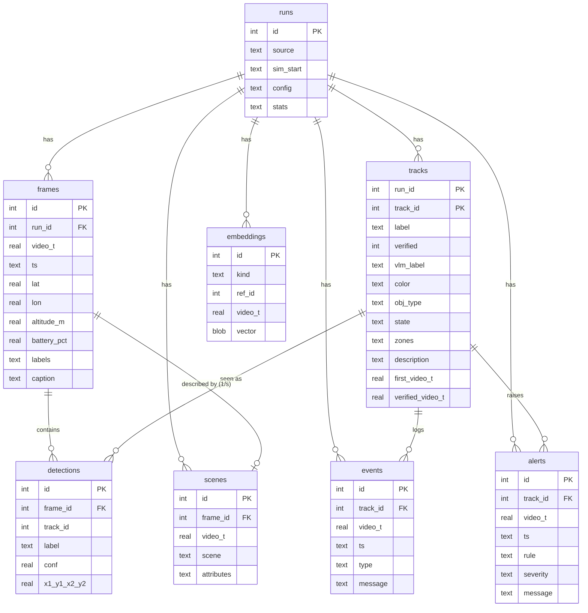

Every row carries both `video_t` (seconds into the clip) and `ts` (wall-clock time), so the index is
queryable by either: `run.py query --label truck`, `--from-s 10 --to-s 15`, `--start 23:59:00`.

---

## 7. Design decisions

| Decision | Why | Alternative considered |
|---|---|---|
| YOLO11s + ByteTrack for detection | Fast (20-50 ms/frame on an RTX 3080), all 80 COCO classes, stable track ids across frames, so each object is logged once | VLM-only detection: too slow for 5 frames/s |
| VLM verifies every object | COCO-trained YOLO makes false positives on drone views; the VLM removes them and adds colour, type, state, location and a description | Trusting YOLO: false logs and alerts |
| qwen3-vl:2b via Ollama (local, free) | 3.1 GB VRAM, fully on the 10 GB GPU, 3-5 s per call, best colours of the models tested | qwen2.5vl:3b spilled to CPU (~47 s/call); qwen2.5vl:7b needed 13 GB (~23 s/call on CPU) |
| One VLM call per second, not per object | Cost is bounded by video length (at most 1 call/s) instead of object count; one call also gives the scene description | One call per object: 10-50 calls per second on busy streets |
| Async VLM on a worker thread | YOLO and logging keep up with the video; verdicts arrive a few seconds later with correct timestamps | Blocking calls: about 4 s pause per second of video |
| Locations as VLM text, not zone polygons | The drone moves, so pixel regions point at different ground every second | Polygons (tried: wrong); segmentation model; GPS geofencing (needs real telemetry) |
| SQLite (WAL) + embeddings as BLOBs | Zero setup, single file, enough for one property's footage; SQL time and label queries | Postgres + pgvector at scale |
| Groq gpt-oss-120b for Q&A | Free tier, fast (~1-3 s), JSON mode; retrieval keeps the prompt small | Local llama3.1 8B (kept as fallback; weaker answers) |
| Retrieval in code, one LLM call per question | Predictable, cheap on the free tier, follow-ups handled by remembering result ids | LangChain tool-calling agent (2-5 calls per question) |

## 8. Measured performance (RTX 3080 10 GB)

| Video | Length | YOLO | VLM | Total | vs real time |
|---|---|---|---|---|---|
| Street, 4K, 30 fps | 23.6 s | 52.8 ms/frame (118 frames) | 24 calls, avg 4.6 s | 137 s | 5.8x slower |
| Night street, 768x432 | 23.0 s | 33.5 ms/frame (115 frames) | 23 calls, avg 3.1 s | 96 s | 4.2x slower |
| Gate breach, 768x432 | 54.2 s | 19.9 ms/frame (260 frames) | 31 calls, avg 3.0 s | 125 s | 2.3x slower |

The VLM is the bottleneck (about 95% of the time). Ways to scale:
- Run several VLM workers (`OLLAMA_NUM_PARALLEL`, or more GPUs); calls are independent.
- For live streams, set a small `vlm.max_in_flight` so seconds are skipped instead of queued.
- Use a vector index (FAISS / pgvector) instead of brute-force similarity once there are days of footage.
- Use a detector trained on aerial images (e.g. VisDrone) to cut false positives before the VLM.
- Use real telemetry and camera angles to place objects on a map (GPS geofences instead of text locations).
